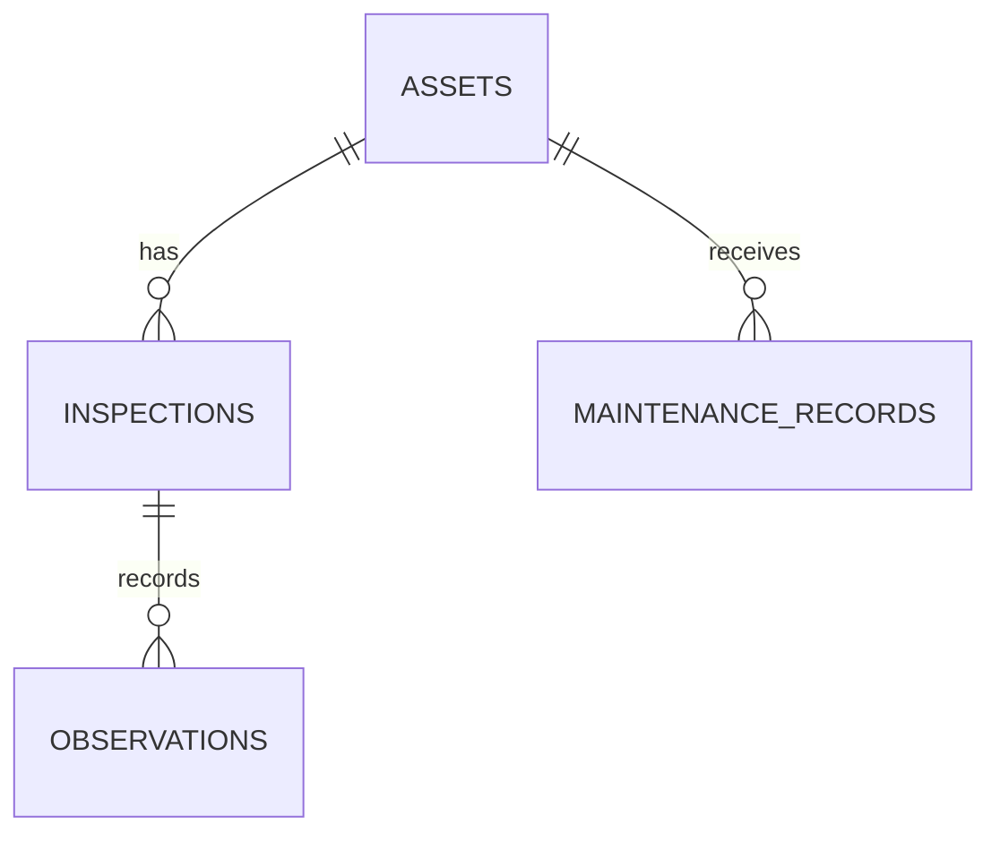

# Solar PV Asset Database

A Python and SQLite system for organizing solar assets, preserving inspection history, and preparing reliable data for future condition-trend analysis.

> **Project status:** Database foundation and Week 1–3 acceptance checks are complete. The dashboard and condition-trend analysis are planned for a later phase.

## At a glance

- **Language:** Python 3.13+
- **Database:** SQLite
- **Testing:** pytest and a repeatable acceptance script
- **Import formats:** CSV folders and JSON files
- **Sample data:** Synthetic only — not real solar research measurements

## Why this project exists

Solar equipment can be inspected many times. Keeping each inspection and its measurements linked to the correct asset makes it easier to review past records and, in a later phase, compare condition over time.

The database is designed to keep asset identity stable, preserve inspection history, retain measurement units and data-quality labels, and handle import errors safely.

## Current capabilities

- Store and retrieve solar assets, inspections, observations, and maintenance records.
- Keep each inspection as a separate historical event.
- Link observations to the inspection where they were recorded.
- Preserve measurement units, data-quality labels, and data origin.
- Import data from a JSON file or a folder of four CSV files.
- Validate imports and reject invalid references before writing records.
- Skip an identical source import using a SHA-256 content fingerprint.
- Use a database transaction so a failed import does not leave a partial batch.
- Run unit tests and acceptance checks locally and through GitHub Actions.

## Verified test dataset

The Week 1–3 synthetic dataset contains:

| Record type | Count |
|---|---:|
| Assets | 20 |
| Inspections | 40 |
| Observations | 80 |
| Maintenance records | 10 |

**Validation result:** 49 unit tests passed, and all Week 1–3 acceptance checks passed in the verified run.

The acceptance checks include inspection coverage, joined history for `PV-001`, duplicate-import handling, invalid observation references, and rollback after a database constraint failure. The sample values are for software testing only; they are not field measurements and must not be used for engineering decisions.

## Quick start (Windows PowerShell)

### 1. Get the code

```powershell
git clone https://github.com/gauravdev0011-code/SolarPV_AssetDatabase.git
cd SolarPV_AssetDatabase
```

### 2. Create an environment and install the project

```powershell
py -3.13 -m venv .venv
.\.venv\Scripts\Activate.ps1
py -m pip install --upgrade pip
py -m pip install -e ".[dev]"
```

If PowerShell blocks environment activation, run the environment's Python directly, for example `.venv\Scripts\python.exe -m pytest -v`.

### 3. Run the tests

```powershell
py -m pytest -v
py scripts/verify_week3_acceptance.py
```

Run both commands after making changes. The acceptance script creates temporary databases and removes them when finished; it does not overwrite the project's normal database.

## Importing sample data

The sample files are in `data/sample/`. The importer accepts either:

- A JSON file with the four top-level arrays `assets`, `inspections`, `observations`, and `maintenance`; or
- A directory containing `assets.csv`, `inspections.csv`, `observations.csv`, and `maintenance.csv`.

After installation, import the sample CSV folder into the default local database with:

```powershell
py -c "from solarpv_db.database import initialize_database; from solarpv_db.importer import import_data; initialize_database(); print(import_data('data/sample'))"
```

The default database path is `data/solarpv.db`. Local databases and private research data should not be committed to Git.

## How the data fits together



The importer also keeps source fingerprints in `imported_files` to recognize identical imports. See the [data dictionary](docs/DATA_DICTIONARY.md) for field definitions and allowed values, and [architecture notes](docs/ARCHITECTURE.md) for the current design.

## Repository layout

```text
migrations/       Database schema
src/solarpv_db/   Database operations and data importer
tests/unit/       Unit tests
data/sample/      Synthetic CSV dataset for testing
scripts/          Repeatable acceptance checks
docs/             Data dictionary and design notes
.github/          GitHub automation and repository templates
```

## Development

Before opening a pull request:

1. Run `py -m pytest -v`.
2. Run `py scripts/verify_week3_acceptance.py`.
3. Update documentation if behavior or the data format changes.
4. Keep sample data clearly labeled as synthetic.

See [CONTRIBUTING.md](CONTRIBUTING.md) for the project workflow.

## Data handling

Do not commit credentials, personal information, private research files, or local database files. Only use research data that has been approved for the repository. Preserve units, data origin, source references, and quality labels when importing observations.

## Roadmap

- [x] Establish the SQLite database foundation.
- [x] Add CSV/JSON import and data-integrity checks.
- [x] Add unit and Week 1–3 acceptance tests.
- [ ] Develop asset history and condition-trend analysis.
- [ ] Build a dashboard after the history and trend requirements are defined.

---

This project is under active development. The current implementation is a tested project foundation, not yet a production deployment or a completed condition-monitoring dashboard.
