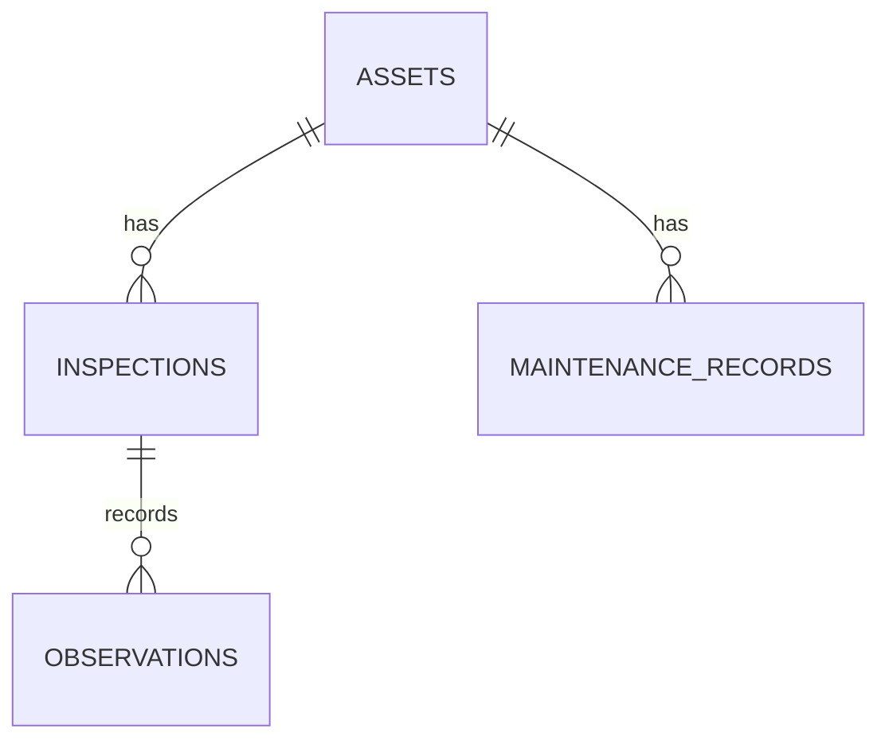

# Architecture Notes

## Purpose

The database stores solar asset identity and the history associated with each asset. It is being built as a foundation for future condition-trend analysis.

## Main parts

- **SQLite schema** — defines the asset, inspection, observation, and maintenance records.
- **Database operations** — create and retrieve records while enforcing required fields and relationships.
- **Importer** — reads a JSON file or a four-file CSV dataset, validates references and values, and writes the import in a transaction.
- **Import tracking** — stores a SHA-256 fingerprint for successfully imported source content so an identical source can be skipped.
- **Tests** — check individual database operations and important end-to-end import behavior.
- **Synthetic sample data** — provides repeatable input for testing without representing real field measurements.

## Record relationships

An asset can have many inspections and maintenance records. An inspection can have many observations. Keeping each inspection separate preserves history instead of replacing older inspection data.

The `imported_files` table tracks imported source content. It is not a solar asset or measurement table.

## Import safety

The importer checks incoming records and their references before writing them. Import writes use a database transaction. If a database constraint fails during the import, the transaction is rolled back so a partial batch is not left behind.

An identical source is identified by its content fingerprint and skipped. A changed source has a different fingerprint; the current importer does not automatically merge it into existing records or update existing assets.

## Data quality

- Store measurement units with numeric values when applicable.
- Keep data origin explicit: `real`, `synthetic`, or `unknown`.
- Keep observation quality explicit: `good`, `suspect`, `invalid`, or `unknown`.
- Treat a missing measurement as missing, not as zero.
- Do not use synthetic sample values as actual research or operating data.

## Current limits

The repository currently contains the database foundation, importer, tests, and acceptance checks. A dashboard and condition-trend analysis have not yet been implemented. Performance at large scale and production deployment have not been established by the current tests.
